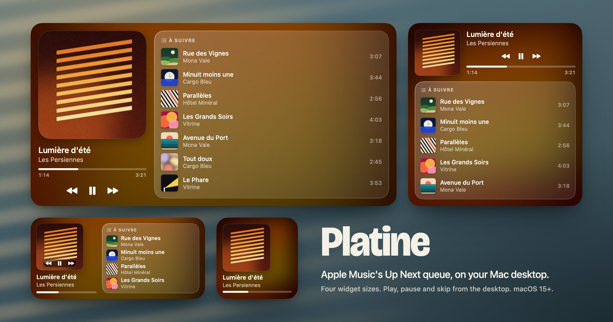

<p align="center">
  
</p>

<h1 align="center">Platine</h1>

<p align="center">
  <strong>La file d'attente d'Apple Music, sur le bureau du Mac.</strong><br/>
  La piste en cours à gauche, ce qui vient ensuite à droite,<br/>
  sur un verre fumé teinté par la pochette.
</p>

<p align="center">
  <a href="#installer"><strong>Installer</strong></a> ·
  <a href="#ce-que-ça-fait">Ce que ça fait</a> ·
  <a href="#comment-ça-marche">Comment ça marche</a> ·
  <a href="#limites-connues">Limites connues</a> ·
  <a href="README.md">English</a>
</p>

---

## Platine, c'est quoi ?

**Platine est un widget de bureau macOS pour Apple Music : il affiche la piste en cours et les pistes qui la suivent dans la file d'attente.** Chaque piste à venir a sa pochette, son artiste et sa durée, et les boutons lancent, mettent en pause et changent de piste sans ouvrir Musique.

Le difficile, c'est la file : ni AppleScript ni aucune API publique ne donne « À suivre » pendant une écoute en streaming. Platine la lit dans le service « lecture en cours » du système. Le chemin est décrit dans [Comment ça marche](#comment-ça-marche).

## Ce que ça fait

- **La file, avec les pochettes.** Jusqu'à sept pistes à venir dans la plus grande taille, chacune avec pochette, artiste et durée.
- **Quatre tailles.** Petit, moyen, grand, très grand. Le petit montre la pochette et la progression, les autres ajoutent la file.
- **Les boutons.** Précédent, lecture ou pause, suivant, à partir de la taille moyenne.
- **Un verre tiré de la pochette.** Le fond est la pochette de l'album, floutée, saturée et assombrie juste assez pour que le texte blanc reste lisible, même sous une pochette blanche.
- **Il avance tout seul.** Le widget reçoit une image par piste à venir, datée d'après les durées : il passe à la chanson suivante sans demander de rechargement à macOS. La barre de progression est animée par le système.
- **Discret.** Ni icône dans le Dock, ni dans la barre des menus. L'agent démarre à l'ouverture de session et ne travaille que quand Musique est ouverte. Seul trafic réseau : le téléchargement des pochettes sur les serveurs d'Apple.

## Installer

Il faut macOS 15 ou plus récent sur Apple Silicon et les Command Line Tools de Xcode (`xcode-select --install`). Ni compte développeur Apple, ni certificat.

```bash
git clone https://github.com/charle-com/widget-apple-music.git
cd widget-apple-music
./build.sh --install
```

Ensuite : clic droit sur le bureau, **Modifier les widgets**, chercher **Platine**.

| Commande | Effet |
|---|---|
| `./build.sh --install` | Construit, signe, installe dans `/Applications` et lance |
| `./build.sh --test` | Lance aussi les tests de la planification de la timeline |
| `./build.sh --uninstall` | Quitte l'app, la retire ainsi que son ouverture de session |
| `Platine --render <dossier> [--sample]` | Rend les quatre tailles en PNG, sans passer par le bureau |

Toujours passer par `--install` : la copie de `build/` n'est pas faite pour être lancée à la main.

## Comment ça marche

1. **L'adaptateur** (`Adapter/adapter.m`). macOS refuse aux apps tierces l'accès à MediaRemote, le framework privé derrière les données de lecture du système, mais l'accorde aux binaires système. L'adaptateur est une petite bibliothèque Objective-C chargée dans `/usr/bin/perl`. Il écrit une ligne JSON à chaque changement : lecture ou pause, position, et les 24 premières pistes de la file avec durée et URL de pochette. L'idée d'héberger le code dans perl vient de [ungive/mediaremote-adapter](https://github.com/ungive/mediaremote-adapter).
2. **L'app hôte** (`Sources/Platine/`). Un agent sans interface. Il ne fait tourner l'adaptateur que quand Musique est ouverte, télécharge chaque pochette une fois et en tire quatre fichiers (600 px, 300 px, vignette, fond flouté), écrit l'état dans `~/Library/Application Support/Platine/state.json` et recharge le widget.
3. **Le widget** (`Sources/PlatineWidget/`). Sandboxé, sans réseau, sans traitement d'image. Il lit l'état et prépare sa timeline d'avance, une entrée par piste à venir.
4. **Les boutons.** Chaque bouton est un lien `platine://play`, `pause`, `next` ou `previous`. macOS l'ouvre dans l'app hôte, qui écrit la commande sur l'entrée standard de l'adaptateur, lequel l'envoie au lecteur. Lecture et pause sont deux commandes distinctes, pas une bascule : un clic répété ne peut pas inverser l'état. Tout le chemin se teste au shell : `open platine://next`.
5. **Les rechargements** (`Sources/PlatineCore/Planner.swift`). macOS les rationne. L'app n'en demande un que si la réalité s'écarte de la timeline déjà envoyée : pause, saut, avance rapide, file modifiée, ou file affichée qui se dégarnit.

Le projet se construit avec SwiftPM et un script shell. Il n'y a pas de projet Xcode : `build.sh` assemble à la main le bundle de l'app et l'extension du widget, puis les signe de l'intérieur vers l'extérieur.

## Limites connues

- **API privée.** La lecture de la file passe par MediaRemote, sans garantie d'Apple. Vérifié sur macOS 27.2.1. Si une mise à jour la casse, le widget garde le dernier état connu. Diagnostic : `~/Library/Logs/Platine/platine.log`.
- **Pochettes.** Seules les pistes dont la pochette est en ligne (catalogue Apple Music) en ont une. Un fichier local sans pochette en ligne affiche une note de musique.
- **Petit widget.** macOS n'y accepte qu'un seul lien, donc pas de boutons : le clic ouvre Musique.
- **Autre lecteur.** Les boutons commandent le lecteur actif du système. Si une vidéo dans un navigateur a pris la main, c'est elle qui reçoit la commande, et le widget reste sur le dernier état de Musique.

## Réglages

Rien à configurer par défaut : le build signe l'app en ad hoc, ce qui ne demande aucun certificat.

Deux réglages facultatifs, lus dans l'environnement ou dans un fichier `build.local.conf` à côté de `build.sh` (une ligne `CLÉ=valeur` par réglage, ignoré par git) :

| Réglage | Par défaut | Rôle |
|---|---|---|
| `SIGNING_IDENTITY` | ad hoc | Nom d'une identité de signature de code du trousseau. L'app et son widget sont signés avec elle. |
| `BUNDLE_ID` | `io.github.charle-com.platine` | Identifiant de l'app. Le widget prend le même, suivi de `.widget`. |

```bash
SIGNING_IDENTITY="Mon identité" ./build.sh --install
```

Si le widget n'apparaît pas dans la galerie après un build ad hoc, signer avec une identité auto-signée : Trousseaux d'accès, **Assistant de certification**, **Créer un certificat**, type **Signature de code**, puis donner son nom dans `SIGNING_IDENTITY`. Une identité fixe garde aussi la même signature d'un build à l'autre.

---

Publié sous [licence MIT](LICENSE). Platine est un projet indépendant, ni affilié à Apple ni approuvé par Apple. Apple Music est une marque d'Apple Inc. Les pistes et les pochettes de la bannière sont fictives.
