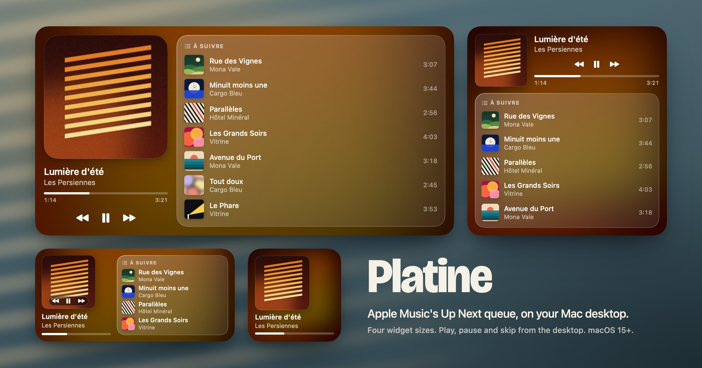

<p align="center">
  
</p>

<h1 align="center">Platine</h1>

<p align="center">
  <strong>Apple Music's Up Next queue, on your Mac desktop.</strong><br/>
  The track playing now on the left, what comes next on the right,<br/>
  on smoked glass tinted by the album cover.
</p>

<p align="center">
  
  
  
  
  
  
</p>

<p align="center">
  <a href="#install"><strong>Install</strong></a> ·
  <a href="#features">Features</a> ·
  <a href="#how-it-works">How it works</a> ·
  <a href="#known-limits">Known limits</a> ·
  <a href="README.fr.md">Français</a>
</p>

---

## What is Platine?

**Platine is a macOS desktop widget for Apple Music that shows the track playing now and the tracks queued after it.** Each upcoming track comes with its cover, its artist and its duration, and you can play, pause and skip without opening Music.

The queue is the hard part: neither AppleScript nor any public API exposes "Up Next" for a streaming session. Platine reads it from the system's own now-playing service. [How it works](#how-it-works) explains the route.

## Features

- **Up Next, with covers.** Up to seven upcoming tracks on the largest size, each with artwork, artist and duration.
- **Four sizes.** Small, medium, large and extra large. The small one is the cover and the progress bar, the others add the queue.
- **Playback buttons.** Previous, play or pause, next, on every size from medium up.
- **Glass made from the cover.** The background is the album cover, blurred, saturated and darkened just enough for white text to stay readable, even under a white cover.
- **It moves on its own.** The widget receives one frame per upcoming track, dated from the track durations, so it steps to the next song without asking macOS for a reload. The progress bar is animated by the system.
- **Out of the way.** No Dock icon, no menu bar icon. The helper starts at login and only works while Music is open. The only network traffic is the download of covers from Apple's artwork servers.

## Install

You need macOS 15 or later on Apple Silicon and the Xcode Command Line Tools (`xcode-select --install`). No Apple developer account, no certificate.

```bash
git clone https://github.com/charle-com/widget-apple-music.git
cd widget-apple-music
./build.sh --install
```

Then right-click the desktop, choose **Edit Widgets** and search for **Platine**.

| Command | What it does |
|---|---|
| `./build.sh --install` | Builds, signs, installs into `/Applications` and launches |
| `./build.sh --test` | Also runs the tests of the timeline planner |
| `./build.sh --uninstall` | Quits the app, removes it and its login item |
| `Platine --render <folder> [--sample]` | Renders the four sizes to PNG, without going through the desktop |

Always go through `--install`: the copy in `build/` is not meant to be launched by hand.

## How it works

1. **The adapter** (`Adapter/adapter.m`). macOS denies third-party apps access to MediaRemote, the private framework behind the system's now-playing data, but grants it to system binaries. The adapter is a small Objective-C library loaded inside `/usr/bin/perl`. It prints one JSON line per change: playing or paused, position, and the first 24 tracks of the queue with duration and artwork URL. The idea of hosting the code in perl comes from [ungive/mediaremote-adapter](https://github.com/ungive/mediaremote-adapter).
2. **The host app** (`Sources/Platine/`). A faceless agent. It runs the adapter only while Music is open, downloads each cover once and derives four files from it (600 px, 300 px, a thumbnail and the blurred background), writes the state to `~/Library/Application Support/Platine/state.json` and reloads the widget.
3. **The widget** (`Sources/PlatineWidget/`). Sandboxed, no network, no image processing. It reads the state and builds its timeline in advance, one entry per upcoming track.
4. **The buttons.** Each button is a link to `platine://play`, `pause`, `next` or `previous`. macOS opens it in the host app, which writes the command to the adapter's standard input, which sends it to the player. Play and pause are two separate commands, not a toggle, so a repeated click can never flip the state. You can test the whole path from a shell: `open platine://next`.
5. **Reloads** (`Sources/PlatineCore/Planner.swift`). macOS rations widget reloads. The app only asks for one when reality drifts from the timeline already sent: pause, skip, seek, edited queue, or a displayed queue that is running short.

The project builds with SwiftPM and a shell script. There is no Xcode project: `build.sh` assembles the app bundle and the widget extension by hand, then signs them from the inside out.

## Known limits

- **Private API.** Reading the queue goes through MediaRemote, with no guarantee from Apple. Verified on macOS 27.2.1. If an update breaks it, the widget keeps the last known state. Diagnosis: `~/Library/Logs/Platine/platine.log`.
- **French interface.** The few labels in the widget ("À suivre", "En pause") are in French for now.
- **Covers.** Only tracks whose artwork is online (the Apple Music catalogue) get a cover. A local file without online artwork shows a music note.
- **Small widget.** macOS accepts a single link there, so it has no buttons: a click opens Music.
- **Other players.** The buttons drive the system's active player. If a video in a browser has taken over, it receives the command, and the widget stays on Music's last state.

## Settings

Nothing to configure by default: the build signs the app ad hoc, which needs no certificate.

Two optional settings, read from the environment or from a `build.local.conf` file next to `build.sh` (one `KEY=value` per line, ignored by git):

| Setting | Default | Purpose |
|---|---|---|
| `SIGNING_IDENTITY` | ad hoc | Name of a code-signing identity in your keychain. The app and its widget are signed with it. |
| `BUNDLE_ID` | `io.github.charle-com.platine` | Identifier of the app. The widget takes the same one, followed by `.widget`. |

```bash
SIGNING_IDENTITY="My Identity" ./build.sh --install
```

If the widget does not show up in the gallery after an ad hoc build, sign with a self-signed identity instead: Keychain Access, **Certificate Assistant**, **Create a Certificate**, type **Code Signing**, then pass its name as `SIGNING_IDENTITY`. A fixed identity also keeps the same signature from one build to the next.

---

Released under the [MIT License](LICENSE). Platine is an independent project, not affiliated with or endorsed by Apple. Apple Music is a trademark of Apple Inc. The tracks and covers in the banner are fictional.
